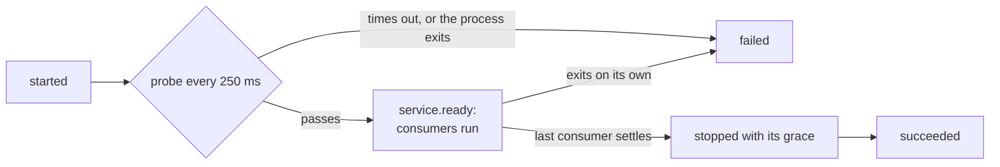

# Services

Integration tests want a database that is up while they run and gone afterwards. A step can't be
that database: senro waits for a step to exit, and a database that never exits looks, to an engine
waiting for exit, exactly like a hang. `Service` declares the difference. senro starts the process,
waits until it answers, tells the steps that need it where it is, and stops it once they are done.

```go
import (
	"github.com/xavidop/senro"
	"github.com/xavidop/senro/exec"
	"github.com/xavidop/senro/executor/container"
	"github.com/xavidop/senro/service"
)

p := senro.New("ci")

infra := p.Workflow("infra", senro.On(container.Image("postgres:16")))
infra.Service("db", exec.Command("postgres"), service.Ports(5432)).
	Env("POSTGRES_HOST_AUTH_METHOD", "trust")

verify := p.Workflow("verify")
verify.Step("integration", exec.Command("go", "test", "./store/...")).
	Needs("db")
```

`service` is `github.com/xavidop/senro/service`. `Service(id, action, opts...)` is a method on the
`*senro.WorkflowBuilder` and returns an ordinary `*senro.StepBuilder`, so `Needs`, `Env`, `WorkDir`,
`Mount`, `Timeout` and `When` work on it as on any step. The test in `example.com/m/store` reads
where the database is from its environment:

```go
dsn := fmt.Sprintf("postgres://postgres@%s:%s/postgres?sslmode=disable",
	os.Getenv("SENRO_SERVICE_DB_HOST"), os.Getenv("SENRO_SERVICE_DB_PORT_5432"))
```

## Why a service is a kind of step

Only the author knows a process is meant to stay up, and only the author knows what "up" means. So
the declaration carries the two facts the engine can't guess: the ports the service listens on, and
the probe that says it is ready. Everything else, where it runs, its environment, its workspaces,
its logs, is the same code an ordinary step goes through, so a service's output is redacted and
archived like any step's and it shows up in every client as a row of its own.

## Declaring one

| Option | What it sets | Default |
|---|---|---|
| `service.Ports(ports...)` | The TCP ports the service listens on. At least one is required | none |
| `service.TCP(port)` | Ready when `port` accepts a connection | TCP on the first port |
| `service.HTTP(port, path)` | Ready when `GET path` on `port` answers `200` to `399` | |
| `service.ReadyTimeout(d)` | How long the probe may take to pass | 60 seconds |
| `service.StopGrace(d)` | How long the service gets to exit once asked to stop, before it is killed | 10 seconds |

Options apply in order, so a later one wins. A bare `service.Ports(5432)` is a database that is
ready when it listens.

```go
api := infra.Service("api", exec.Command("./bin/api"),
	service.Ports(8080, 9090),
	service.HTTP(8080, "/healthz"),
	service.ReadyTimeout(2*time.Minute))
```

`TCP` and `HTTP` name a port; they don't add it to `Ports`. A probe on a port the service never
declared is refused at `Build`, not silently trusted. An HTTP probe follows no redirect: a `302`
to a login page counts as up, and a `503` from a server still starting does not.

A TCP probe passes when a connection is accepted **and not dropped**: senro waits 200 ms on it,
and silence or any bytes (a greeting) mean ready, while a connection closed at once means nothing
is listening yet. That matters for a container. Docker's port forwarder accepts on the published
port from the moment the container starts, before the server inside is listening, and drops each
connection it can't pass on. A server that accepts and then hangs up straight away without a
word never reads as ready; give it an HTTP probe, or a port that holds the connection.

**The probe runs from the coordinator**, against the address the service is published on. That is
the vantage a person on the coordinator has, and the one the engine can use on every executor: a
probe that ran inside the service's container would pass for a port the host can't reach. For a
local service that address is `127.0.0.1` on the declared port, IPv4: a server bound only to `::1`
never becomes ready. Bind `127.0.0.1` or every interface.

A local service whose declared port something on the coordinator already holds is not started:
it fails with `localexec: port 5432 is already in use`. Otherwise the probe would pass against
whatever owns the port, your own database or a previous run's leftover, and hand that to the
consumers as this service.

## Where the service is: `SENRO_SERVICE_*`

A step that names a service in its `Needs` gets two kinds of variable for it:

| Variable | Value |
|---|---|
| `SENRO_SERVICE_<ID>_HOST` | The host to connect to |
| `SENRO_SERVICE_<ID>_PORT_<declared>` | The port to connect to for that declared port, one per port |

`<ID>` is the step id upper-cased, with every character that is not an ASCII letter or digit
replaced by `_`: `db` is `SENRO_SERVICE_DB`, `infra/db` is `SENRO_SERVICE_INFRA_DB`. The port in the
variable's **name** is always the one you declared; its **value** is the port to dial from where
the consumer runs, which is not always the same number.

A local service binds its declared port itself on the coordinator. A container service's ports
are published by the daemon to `127.0.0.1` on free ports. The address a consumer is given depends
on **both** ends, because no one address works for every pair on native Linux, where a container
can't reach the coordinator's loopback:

| Service | Consumer | `_HOST` | `_PORT_<declared>` |
|---|---|---|---|
| local | local | `127.0.0.1` | the declared port |
| container | local | `127.0.0.1` | the published port, `54321` say |
| container | container | the service container's bridge IP, `172.17.0.3` say | the declared port |
| local | container | `host.docker.internal` | the declared port |

`service.ready` and `senro up` always show the published coordinator address, the one a person on
the coordinator dials.

**A local service consumed from a container, on native Linux.** The consumer's container is
created with `--add-host host.docker.internal:host-gateway`, so the name resolves to the Docker
bridge's gateway, an address of the coordinator's on the bridge network. A server bound to
`127.0.0.1` is not listening there. Bind it to every interface (`0.0.0.0`) or to the gateway's
address, and check that a host firewall such as `ufw` lets the bridge reach the port. Docker
Desktop forwards `host.docker.internal` to the host's loopback, so there it works either way.

Three things worth knowing:

- **Only a direct `Needs` gets the variables.** A step that needs a step that needs `db` is told
  nothing about `db`. Name the service in `Needs` to reach it: that is also what keeps it up until
  your step is done.
- **The variables never enter a cache key.** A published port is different every run, so digesting
  it would make a `Pure()` consumer miss every time. They are left out for the same reason the
  trace context is. What the service **is** does enter: a `Pure()` consumer's key carries the
  digest of each service it needs directly, so changing the service's image or command misses.
  See [Cache keys](/docs/data/cache-keys/).
- **The address carries a host and a port, nothing else.** A credential the service needs is the
  service's own `SecretEnv`, never part of what its consumers are told.

## Lifecycle



1. **Started** through its executor, in the same sandbox, environment and log plumbing as a step.
2. **Probed** straight away, then every 250 ms, until the probe passes. The limit is `ReadyTimeout`,
   or the step's `Timeout` when that is shorter. On a service, `Timeout` bounds the time to become
   ready, never its lifetime: the run decides how long it stays up.
3. **Ready.** senro emits `service.ready` with every endpoint, then dispatches the steps that need
   it. None of them starts before that event is in the ledger.
4. **Stopped** once every step that names it in `Needs` has settled, or straight after it became
   ready when nothing needs it. senro asks it to stop (`SIGTERM` to its process group locally,
   `docker stop` in a container), waits up to `StopGrace`, then kills it. A container service runs
   under an init (`docker run --init`), so a server that installs no `SIGTERM` handler of its own
   still stops on the signal rather than at the kill. Locally, a wrapper that already exited on its
   own has its process group killed anyway, so a child it left behind doesn't keep the port.

A consumer that runs again after its service stopped, through `step.retry`, `run.rerun_from` or an
accepted analysis, restarts the service first: the service gets a new attempt, a new probe and new
endpoints, and the consumer starts once that `service.ready` is in the ledger. A service that
fails to come back leaves the consumer `skipped_upstream_failed`.

A ready service is waiting, not working, so it gives back its parallel slot the moment it is ready.
Holding it for its whole life would starve its own consumers under a small limit, and deadlock them
with a limit of one.

### How a service ends

| What happened | State | Its consumers |
|---|---|---|
| senro stopped it after its consumers settled | `succeeded`, exit code `0` whatever status the stop produced | Ran |
| The same, after an operator's `step.retry` of a failed service | `recovered` | Ran |
| The probe didn't pass in time: `not ready after 1m0s` | `failed` | `skipped_upstream_failed` |
| It exited before it was ready: `exited with status 1 before it was ready` | `failed` | `skipped_upstream_failed` |
| It exited while consumers still needed it: `exited with status 1 before its consumers finished` | `failed` | Whatever is still waiting is `skipped_upstream_failed` |
| The run was cancelled before it was ready | `cancelled` | |
| The run was cancelled after it was ready | `succeeded`: being stopped is the end a service is meant to have | |

A `SIGTERM` exit status is the expected end of a service, which is why a clean stop is
`succeeded` with exit `0`. The service's `step.finished` carries the duration from start to stop.
`recovered` keeps the rule [Step states](/docs/steps/states/) gives every step: a dependency that
needed a second try should not look like one that didn't.

## `senro up`: just the services

```bash
senro up ./ci
```

```
db  127.0.0.1:54321  (port 5432)
```

`senro up` builds and runs the pipeline like [`senro run`](/docs/cli/run/), with `SENRO_UP=1` in
its environment. The pipeline then runs every service and whatever those services need,
transitively, and nothing else: every other step is skipped as `not selected`. Services are held
up until you press `Ctrl-C`, instead of stopping when their consumers settle, so you can point a
local process or a debugger at them. Under the plain and none UI modes it prints one line per
endpoint as each service becomes ready. The TUI owns the terminal, so there the address is in
the focused service's log header instead.

`Ctrl-C` ending a session with every service healthy exits `0`. A service that failed exits `1`.
A pipeline that declares no services exits `2` with `this pipeline declares no services`. See
[`senro up`](/docs/cli/run/#senro-up).

From Go, `senro.WithHoldServices()` is the half of this that keeps services up.

## What `Build` refuses

Each of these assumes a step that finishes, or a place senro can't reach:

- **A service on a [Go function step](/docs/steps/functions/).** A function runs in-process and
  returns; there is no process to keep up and no port for it to listen on.
- **No ports.** The probe needs one, and the service's consumers reach it through one.
- **A port outside 1 to 65535, or the same port twice.**
- **A probe on a port not in `Ports`.**
- **An HTTP probe whose path doesn't start with `/`, or a TCP probe with a path.** A TCP probe
  sends nothing, so a path there means you wanted `service.HTTP`.
- **A negative `ReadyTimeout` or `StopGrace`.**
- **`Retry`.** A service that exits has failed, and restarting it would hand its consumers a
  different instance than the one they started against.
- **`Pure`.** A service produces no result to cache, and a hit would skip starting the process its
  consumers need.
- **`Generates`.** A service never finishes, so it has no output to read a fragment from.
- **`OnFailure` or `Always`.** A service's lifetime ends when the run stops it, not when it settles,
  so a handler would run at a moment that means nothing. A handler can't be a service either.
- **Any executor but local or container.** The probe runs from the coordinator and consumers reach
  the service through a port on it. Only those two put a listening process where the coordinator
  can connect.

## In the event stream

```json
{"type":"service.ready","step":"db","attempt":1,
 "payload":{"endpoints":[{"port":5432,"address":"127.0.0.1:54321"}],"duration_ns":2140000000}}
```

`duration_ns` is how long the service took to become ready. `step.created` carries
`"service":true` for a service, so a client can show it as starting before its probe has passed.
`Apply` folds these into `StepState.IsService` (`is_service`) and `StepState.Service` (`service`:
when it became ready, and its endpoints). The endpoints stay after the service stops, so a failure it caused can still say
where it listened, while `Ready()` is true only while it is up. See
[The event stream](/docs/run/event-stream/).

The terminal UI labels a running service `ready` once its probe has passed, and the focused
service's log header says `ready at 127.0.0.1:54321 (port 5432)`, or `ran at` once it has stopped.
The plain renderer prints `db ready at 127.0.0.1:54321 (port 5432)`, and the browser UI gives it a
`ready` badge.

## Limits

- **No Kubernetes or SSH services, for now.** Kubernetes needs a `Service` object and pod DNS; SSH
  needs a tunnel. Both are follow-ups.
- **TCP and HTTP probes only.** No command probe run inside the service, because both kinds run
  from the coordinator and one probe loop then serves every executor.
- **No per-run network.** Containers reach a container service on the daemon's default bridge,
  and everything else goes through the coordinator. See the table above.
- **A service reads its workspaces, it never produces them.** It sees a private, read-only copy
  of each workspace directory as it was when the service started, not later changes. It is a copy
  of the directory itself, not of a snapshot, so the snapshot excludes don't apply: `node_modules`
  and anything a step wrote without snapshotting are there. senro holds the
  workspace only while it makes the copy, so a long-lived service never blocks a sibling's cache
  restore, and that restore can't change what the running service sees. A write under a mount
  fails, and a service takes no snapshot when it stops, so nothing it writes reaches the ledger, a
  cache key or its consumers. Write scratch data to a temporary directory instead.
- **No retries, `Pure`, `Generates` or handlers on a service.** See above.

## Where to go next

- **[Executors](/docs/executors/)**: which ones host a service.
- **[`senro run` and `senro up`](/docs/cli/run/)**: the commands in full.
- **[Step states](/docs/steps/states/)**: what `succeeded`, `recovered` and `failed` mean for every
  step.
- **[The event stream](/docs/run/event-stream/)**: where `service.ready` sits among the other types.
